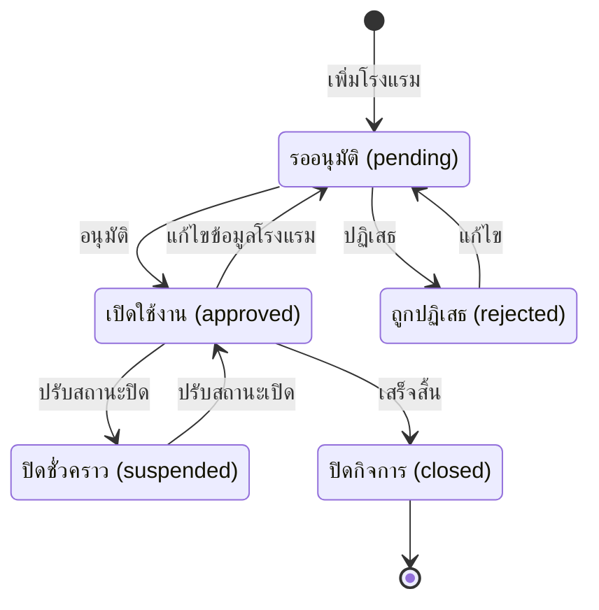
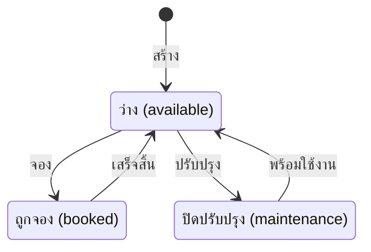
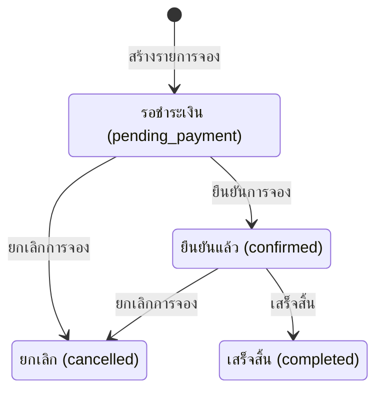
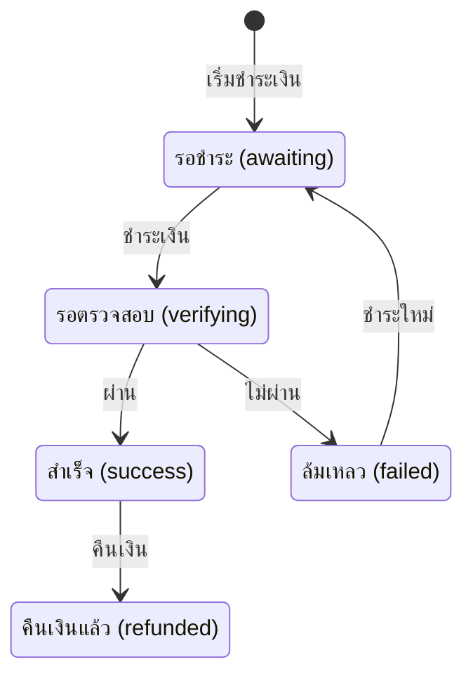
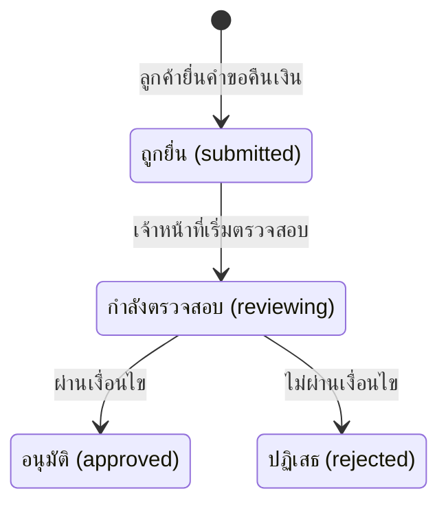

<!-- path: docs/ARCHITECTURE.md -->

# Architecture & Business Logic (Adoga Mockup)

> Functional prototype เพื่อแสดงความถูกต้องตาม SA (State Diagram 5 ใบ) และตรวจ UX/UI ไม่ใช่ระบบจริง: ไม่มี Backend, ไม่ hash password, ไม่ต้องรองรับหลาย Tab

## 1. Tech & Folder Structure

Vue 3 (`<script setup>`) + Vite + Vue Router + Tailwind CSS + `lucide-vue-next` + `chart.js` + `vue-chartjs`. **ไม่ใช้ Pinia**

```
src/
  constants/   status.js (label+สี), team.js (สมาชิก placeholder), images.js
  utils/       storage.js (get/set JSON), stateMachine.js (กฎเปลี่ยนสถานะ), date.js
  data/        seed.js (สร้าง Seed Data)
  stores/      db.js (reactive state + auto persist), session.js
  services/    hotelService, roomService, bookingService, paymentService, refundService
  components/  common/ (StatusBadge, StatusStepper, Footer, Modal, Toast), auth/, manager/, admin/
  views/       ดู README.md
  router/      index.js (beforeEach guard)
```

## 2. State Management (LocalStorage Database)

`stores/db.js` export `db = reactive({...})` โหลดจาก `localStorage` ตอนเริ่ม และ `watch(deep)` เขียนกลับอัตโนมัติ → UI อัปเดตเองทุกหน้า View **ห้ามแก้ `db` ตรง ๆ** ให้เรียกผ่าน `services/` เท่านั้น

| Key | ข้อมูล |
|---|---|
| `adoga_users` | ผู้ใช้ทุก Role |
| `adoga_hotels` | โรงแรม (มี `status`) |
| `adoga_rooms` | ห้องพักรายห้อง (มี `status`) |
| `adoga_bookings` | การจอง (มี `status`) |
| `adoga_payments` | การชำระเงิน (มี `status`) 1 booking : 1 payment |
| `adoga_refunds` | ใบขอคืนเงิน (มี `status`) |
| `adoga_reviews` | รีวิว |
| `adoga_messages` | แชท |
| `adoga_settings` | `{ enableRefund: false }` |
| `adoga_current_session` | `{ userId, role }` หรือ null |
| `adoga_meta` | `{ seeded: true, version: 1 }` ถ้า version เปลี่ยนให้ reseed |

## 3. Authentication & Access Control

### 3.1 ระบบ Auth ที่ใช้ (Mock ล้วน)
- **ไม่มี Backend / ไม่มี API / ไม่มี OAuth จริง** `services/authService.js` อ่าน-เขียน `adoga_users` ใน `localStorage` ตรง ๆ (password เก็บ plain text)
- Session = `adoga_current_session` (`{ userId, role }`) ถ้าเป็น `null` = **Guest** (Guest ไม่ใช่ Role ใน `adoga_users`)
- Validation ทำฝั่ง client ทั้งหมดที่ `utils/validators.js` (ใช้ซ้ำใน Register และ Forgot Password)
- เข้าใช้งานได้ 2 แบบ: **(1) สมัคร → Login** หรือ **(2) กด "เข้าชมแบบ Guest"** (ปุ่มอยู่หน้า Auth และ Navbar)

### 3.2 Register (2 ขั้นตอน)
**ขั้น 1 — ข้อมูลบัญชี** (validate ตอน blur + ตอนกด "ถัดไป" แสดงข้อความแดงใต้ช่อง, ปุ่ม "ถัดไป" disable จนกว่าจะผ่านทุกช่อง)

| ช่อง | กฎ | ข้อความเตือน |
|---|---|---|
| อีเมล | trim + lowercase, regex `^[^\s@]+@[^\s@]+\.[^\s@]+$`, ห้ามซ้ำใน `adoga_users` | "กรุณากรอกอีเมล" · "รูปแบบอีเมลไม่ถูกต้อง (เช่น name@example.com)" · "อีเมลนี้ถูกใช้งานแล้ว" |
| รหัสผ่าน | ≥ 8 ตัว · มี A-Z · มี a-z · มี 0-9 · ห้ามมีช่องว่าง | "ต้องมีอย่างน้อย 8 ตัวอักษร" · "ต้องมีตัวพิมพ์ใหญ่ (A-Z)" · "ต้องมีตัวพิมพ์เล็ก (a-z)" · "ต้องมีตัวเลข (0-9)" · "ห้ามมีช่องว่าง" |
| ยืนยันรหัสผ่าน | ต้องตรงกับรหัสผ่าน | "รหัสผ่านไม่ตรงกัน" |
| ชื่อ / นามสกุล | จำเป็น, 1–50 ตัวอักษร | "กรุณากรอกชื่อ" / "กรุณากรอกนามสกุล" |
| ชื่อเล่น | ไม่บังคับ (ถ้าว่างใช้ชื่อจริงแทน) | — |

- แสดง **Password checklist แบบ live** ใต้ช่องรหัสผ่าน (✓ เขียว / ✗ เทา ทีละข้อ) + ปุ่มแสดง/ซ่อนรหัส (ไอคอน Eye)

**ขั้น 2 — เลือกบทบาท** (การ์ด 3 ใบ: User / Manager / Admin พร้อมคำอธิบายสั้น ๆ, **ไม่มีค่า default** ต้องเลือกเอง)
- ไม่เลือกแล้วกด "สมัครสมาชิก" → "กรุณาเลือกบทบาท"
- สมัครสำเร็จ → สร้าง user (`id` = `U|M|A` + running number) → Toast "สมัครสมาชิกสำเร็จ กรุณาเข้าสู่ระบบ" → สลับไปแท็บ Login พร้อม prefill อีเมล (**ไม่ auto-login** เพื่อให้เดโม flow Login ตามข้อมูลที่ลงทะเบียนไว้)
- เลือก Admin เองได้ เพราะเป็น Mockup

### 3.3 Login
- กรอกอีเมล + รหัสผ่าน → เทียบกับ `adoga_users` **(Login ไม่ตรวจ password policy ตรวจแค่ว่าตรงกัน)**
- Role มาจากข้อมูลที่ลงทะเบียนไว้ ไม่ต้องเลือกตอน Login
- ข้อความ: "ไม่พบอีเมลนี้ในระบบ กรุณาลงทะเบียน" · "รหัสผ่านไม่ถูกต้อง"
- สำเร็จ → บันทึก session → ไป `?redirect=` ถ้ามี ไม่งั้นไปหน้าแรกของ Role (user→`/`, manager→`/manager`, admin→`/admin`)
- ปุ่ม **Demo Accounts** (⭐) กดเติมอีเมล/รหัสของแต่ละ Role ให้

### 3.4 Guest Mode (เข้าชม Mockup โดยไม่ลงทะเบียน)
Guest ดูได้: Home, ผลค้นหา, Hotel Detail (เฉพาะโรงแรม `approved`)

**Action ที่ต้อง Login** — Guest กดแล้ว **ต้อง redirect ไป `/auth?redirect=<path เดิม>&reason=login_required`** พร้อมแจ้งเตือน **"กรุณาลงทะเบียนให้เรียบร้อยก่อนใช้งาน"** (ทั้ง Toast + แถบ Alert สีส้มค้างบนหน้า Auth ที่เห็น `reason=login_required`):

| Action | จุดที่ดัก |
|---|---|
| จองห้อง / เลือกห้อง / ชำระเงิน | ปุ่มใน HotelDetail + route `/booking/:hotelId` |
| แชทกับโรงแรม | ปุ่มแชทใน HotelDetail + `/messages` |
| โปรไฟล์ / ประวัติการจอง | Navbar + `/profile` |
| ขอคืนเงิน | อยู่ใน `/profile` (ถึงหน้าไม่ได้อยู่แล้ว) |
| หน้า Manager / Admin | `/manager*`, `/admin*` |

ดักสองชั้น: **(1)** UI — ทุกปุ่มที่ต้อง Login เรียก `requireAuth(next)` (composable ใน `stores/session.js`) ถ้า session ว่าง → redirect ตามด้านบน **(2)** Router `beforeEach` เป็นตาข่ายสุดท้ายกรณีพิมพ์ URL ตรง

### 3.5 Route & Role Guard
ใช้ **Vue Router `beforeEach`** อ่าน `adoga_current_session` เทียบกับ `to.meta`

| Route | View | Access |
|---|---|---|
| `/` (รวมผลค้นหาผ่าน `?q=`) | Home | Guest, User, Manager, Admin |
| `/hotel/:id` | HotelDetail | ทุกคน (Guest เห็นเฉพาะโรงแรม `approved`) |
| `/auth`, `/auth/forgot` | Auth, ForgotPassword | ทุกคน (Login แล้วเด้งไปหน้าแรกของ Role) |
| `/booking/:hotelId` | BookingFlow | `user` |
| `/messages`, `/profile` | UserMessage, UserProfile | `user` |
| `/manager`, `/manager/messages`, `/manager/guests` | Manager* | `manager` |
| `/admin`, `/admin/approval`, `/admin/settings` | Admin* | `admin` |

- Guest เข้าหน้าที่ต้อง Login → ตามข้อ 3.4
- Login แล้วแต่ Role ไม่ตรง (เช่น User พิมพ์ `/admin`) → redirect ไปหน้าแรกของ Role ตัวเอง + Toast "ไม่มีสิทธิ์เข้าถึงหน้านี้"
- Manager/Admin เปิดหน้า Home/Detail ได้ แต่ปุ่มจองเป็น disabled ("เฉพาะบัญชีผู้ใช้")
- Logout → ล้าง session → กลับ Home ในสถานะ Guest

### 3.6 Google (Mock) และ Forgot Password
- **ปุ่ม Google:** ไม่มี API จริง กดแล้วไป Register ขั้น 1 พร้อม prefill อีเมล `demo.user<เลขสุ่ม 3 หลัก>@gmail.com` (ช่องอีเมล readonly, กันซ้ำตอนเดโมหลายรอบ) ผู้ใช้ยังต้องตั้งรหัสผ่านตาม policy และเลือก Role ต่อ (`provider: 'google'`)
- **Forgot Password:** กรอกอีเมล (ต้องมีในระบบ) → สุ่ม PIN 6 หลัก แสดงใน Toast ("PIN จำลอง: 482910") → กรอก PIN ถูก → ตั้งรหัสใหม่ **ต้องผ่าน password policy เดียวกับ Register** + ยืนยันรหัส

## 4. State Machines (หัวใจของงาน SA)

ทุกเอนทิตีที่มี `status` ต้องเปลี่ยนผ่าน `utils/stateMachine.js` เท่านั้น ถ้าเปลี่ยนผิดกฎให้ `throw Error` (ห้ามเขียน `x.status = '...'` ตรง ๆ)

```js
export const TRANSITIONS = {
  hotel:   { pending: ['approved','rejected'], approved: ['pending','suspended','closed'],
             rejected: ['pending'], suspended: ['approved'], closed: [] },
  room:    { available: ['booked','maintenance'], booked: ['available'], maintenance: ['available'] },
  booking: { pending_payment: ['confirmed','cancelled'], confirmed: ['completed','cancelled'],
             completed: [], cancelled: [] },
  payment: { awaiting: ['verifying'], verifying: ['success','failed'], failed: ['awaiting'],
             success: ['refunded'], refunded: [] },
  refund:  { submitted: ['reviewing'], reviewing: ['approved','rejected'], approved: [], rejected: [] },
}
// transition(entity, record, to): ตรวจกฎ -> set record.status -> push { status, at } เข้า record.statusHistory
```

### 4.1 โรงแรม (Hotel)

| Transition | ผู้กระทำ | หมายเหตุ |
|---|---|---|
| ∅→pending | Manager | ฟอร์มเพิ่มโรงแรม |
| pending→approved / rejected | Admin | Reject ต้องกรอก `rejectReason` (แสดงให้ Manager เห็น) |
| rejected→pending | Manager | กดแก้ไข+ส่งใหม่ |
| approved→pending | Manager | แก้ข้อมูลหลัก (ชื่อ, ที่ตั้ง, ราคา, รูป) → ต้องมี confirm dialog เตือนว่าโรงแรมจะหายจากหน้าค้นหาจนกว่า Admin อนุมัติใหม่ |
| approved⇄suspended | Manager | ปุ่ม เปิด/ปิดชั่วคราว |
| approved→closed | Manager | ทำได้เมื่อไม่มี booking สถานะ `pending_payment`/`confirmed` ค้างอยู่ ไม่งั้นบล็อก |

**แสดงในหน้าค้นหา/Detail ของ Guest-User เฉพาะ `approved`**

### 4.2 ห้องพัก (Room)

- ห้องเป็น "ห้องรายห้อง" (เช่น ห้อง 101) มี `type` ไว้จัดกลุ่มบนหน้า Detail ("Deluxe – เหลือ 2 ห้อง")
- **ลดความซับซ้อน:** สถานะห้องคือสถานะ *ปัจจุบัน* ไม่ผูกช่วงวันที่ (ไม่ทำ date-overlap) ห้องเป็น `booked` ตั้งแต่สร้าง booking จนจบ
- `booked→available` ("เสร็จสิ้น") เกิดเมื่อ: เช็คเอาท์ / จอง cancelled (หมดเวลา, ยกเลิก, คืนเงินอนุมัติ)
- Manager เปลี่ยน `available⇄maintenance` เองได้ (ห้ามเมื่อ `booked`)
- สถานะ final ของห้อง = ลบห้อง ทำได้เฉพาะตอน `available`

### 4.3 การจอง (Booking)

- `expiresAt = createdAt + 12 ชม.` เกินเวลาแล้วยังเป็น `pending_payment` → `cancelled` + `cancelReason: 'expired'`
- **Lazy check:** เรียก `bookingService.sweepExpired()` ตอนเปิดแอป และก่อนอ่านรายการ booking ทุกครั้ง (ไม่มี timer เบื้องหลัง) Countdown บน UI ใช้ `setInterval` เฉพาะหน้า BookingFlow/ประวัติ
- `cancelReason`: `'expired' | 'user' | 'refunded'`
- User ยกเลิกเองได้เฉพาะ `pending_payment` ส่วน `confirmed` ยกเลิกได้ผ่านการคืนเงินที่ Admin อนุมัติเท่านั้น
- เช็คอิน/เช็คเอาท์: `checkedInAt` / `checkedOutAt` (เช็คอินไม่เปลี่ยน status; เช็คเอาท์ → `completed`) UI แสดงป้าย "เข้าพักอยู่" เป็น *derived label* (`confirmed` + มี `checkedInAt` + ไม่มี `checkedOutAt`) ไม่ใช่ state ใหม่

### 4.4 การชำระเงิน (Payment)

- สร้าง payment (`awaiting`) พร้อมกับ booking
- **จำลองการตรวจสอบ:** กด "ชำระเงิน" → `verifying` (spinner 2 วินาที) → ผลลัพธ์ตามสวิตช์ **"จำลองผล: ผ่าน / ไม่ผ่าน"** ใน Payment Modal (default = ผ่าน) เพื่อเดโมทั้งสองเส้นทางให้อาจารย์เห็น
- `success` → booking `pending_payment→confirmed`; `failed` → booking ยังเป็น `pending_payment` (countdown เดินต่อ) แล้วกด "ชำระใหม่"

### 4.5 ใบขอคืนเงิน (Refund)

- "เจ้าหน้าที่" = **Manager** (แท็บ "คำขอคืนเงิน" ในหน้า Dashboard ของผู้จัดการโรงแรม)
- ยื่นได้เมื่อ: `settings.enableRefund === true` + booking `confirmed` + payment `success` + ยังไม่เช็คเอาท์ + booking นั้นยังไม่เคยมีใบขอคืน (1 booking : 1 refund)
- Reject ต้องกรอก `rejectReason`

## 5. Cascade Rules (Service Layer)

ทุก action ต้องทำผ่าน function เดียวที่ update ทุกเอนทิตีที่เกี่ยวข้องพร้อมกัน:

| Action | ผู้กระทำ | ผลที่ต้องเกิด |
|---|---|---|
| `createBooking` | User | room `available→booked` · booking สร้างเป็น `pending_payment` (`expiresAt`=+12ชม.) · payment สร้างเป็น `awaiting` |
| `startPayment(method)` | User | payment `awaiting→verifying` |
| `finishPayment(success)` | ระบบจำลอง | **ผ่าน:** payment→`success`, booking→`confirmed` · **ไม่ผ่าน:** payment→`failed` |
| `retryPayment` | User | payment `failed→awaiting` |
| `cancelBooking` / `sweepExpired` | User / ระบบ | booking→`cancelled` (+`cancelReason`) · room `booked→available` |
| `requestRefund` | User | refund สร้างเป็น `submitted` |
| `startReview` | Manager | refund `submitted→reviewing` |
| `approveRefund` | Manager | refund→`approved` · payment `success→refunded` · booking `confirmed→cancelled` (`refunded`) · room→`available` |
| `rejectRefund` | Manager | refund→`rejected` (booking/payment ไม่เปลี่ยน) |
| `checkIn` | Manager | booking.`checkedInAt = now` |
| `checkOut` | Manager | booking `confirmed→completed` + `checkedOutAt` · room `booked→available` |
| `approveHotel` / `rejectHotel` | Admin | hotel status ตาม 4.1 |

## 6. Beta Feature Toggle

`adoga_settings.enableRefund` (default `false`) แก้ได้ที่ Admin Settings มีผลทันที
- `false`: ปุ่มขอคืนเงินในประวัติการจองของ User เป็น disabled + ข้อความ "Coming Soon…"
- `true`: ปุ่มใช้งานได้ตามเงื่อนไขข้อ 4.5

## 7. UI Status Display Rules (สำคัญ)

1. ทุกที่ที่แสดง hotel/room/booking/payment/refund ต้องมี `<StatusBadge entity="..." :value="..." />` เสมอ (ป้ายสี + ไอคอน + ข้อความไทย) ห้ามแสดง raw string
2. Label/สี อยู่ที่ `constants/status.js` ที่เดียว (ดูตารางใน README.md)
3. หน้าที่มีลำดับขั้น (รายละเอียด booking, ใบขอคืนเงิน) แสดง `<StatusStepper>` เช่น `รอชำระเงิน → ยืนยันแล้ว → เสร็จสิ้น` โดยไฮไลต์ขั้นปัจจุบัน และแสดงสาขา "ยกเลิก" เมื่อเกิดขึ้น
4. ปุ่ม action ต้อง **ซ่อน/disable ตามสถานะ** (เช่น "ชำระเงิน" ปรากฏเฉพาะ `awaiting`/`failed`)

## 8. Out of Scope

Backend, OAuth/Google จริง, ยืนยันอีเมลจริง, hash password, sync ข้าม Tab, ระบบค้นหาห้องว่างตามช่วงวันที่ (date-overlap), ชำระเงินจริง, การแจ้งเตือนอีเมล
